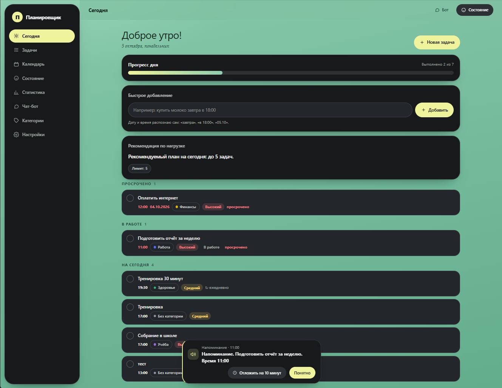
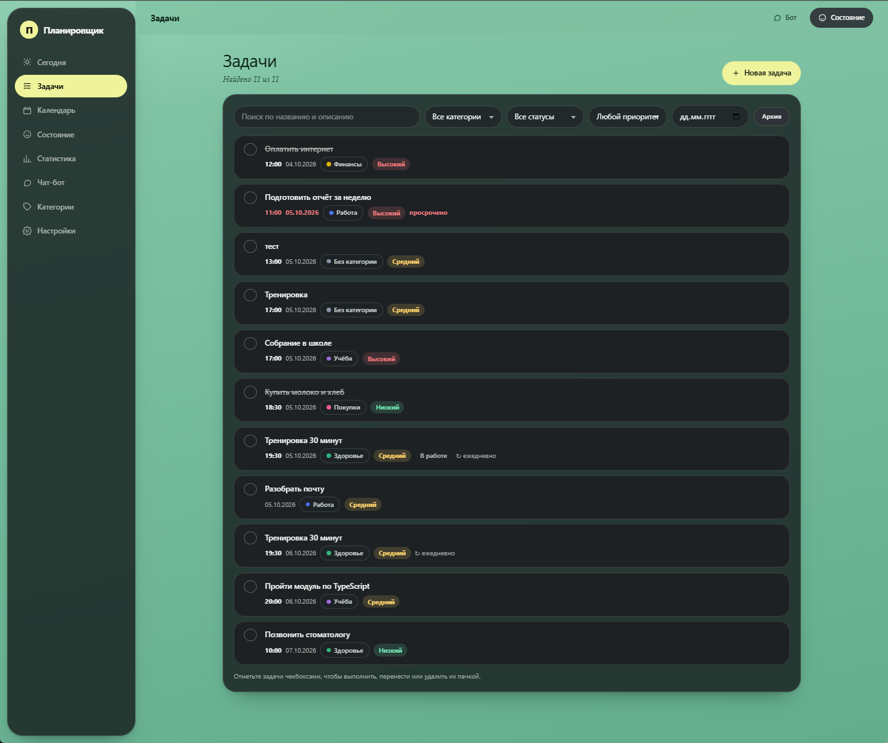
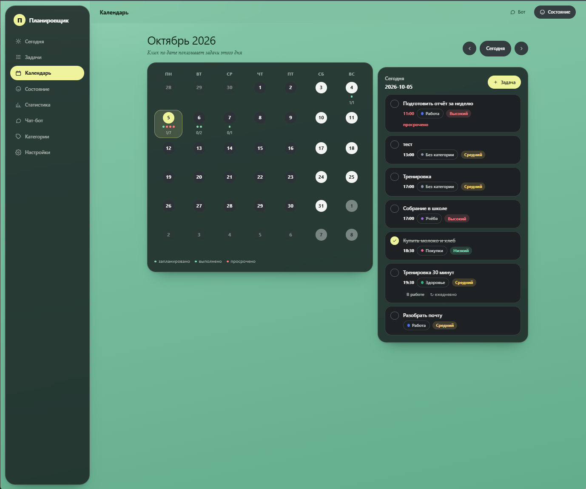
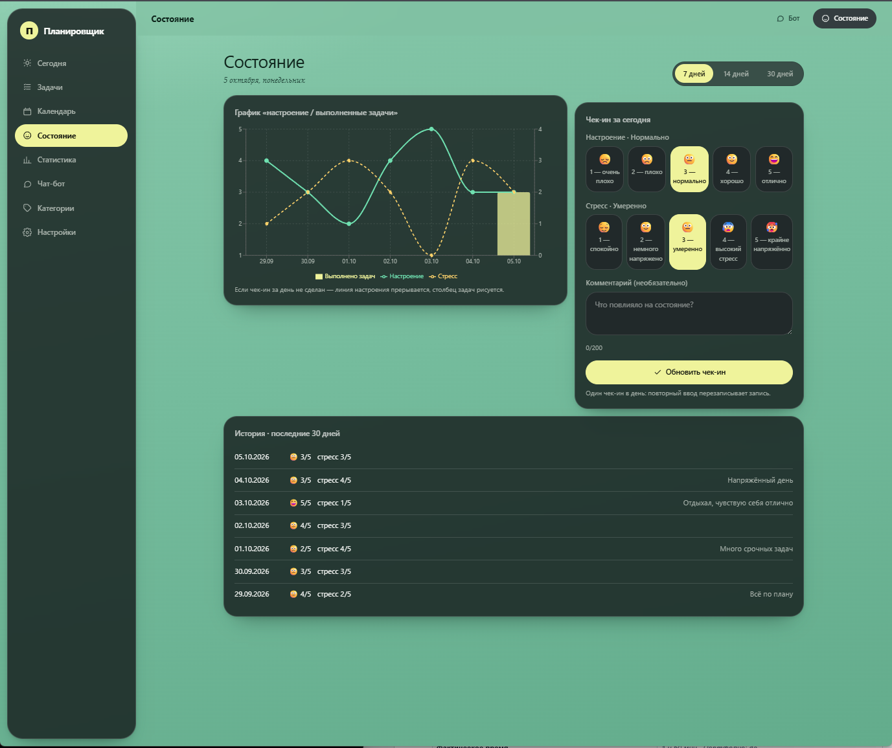
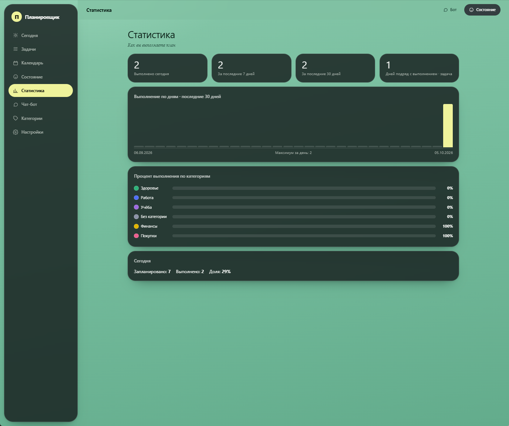
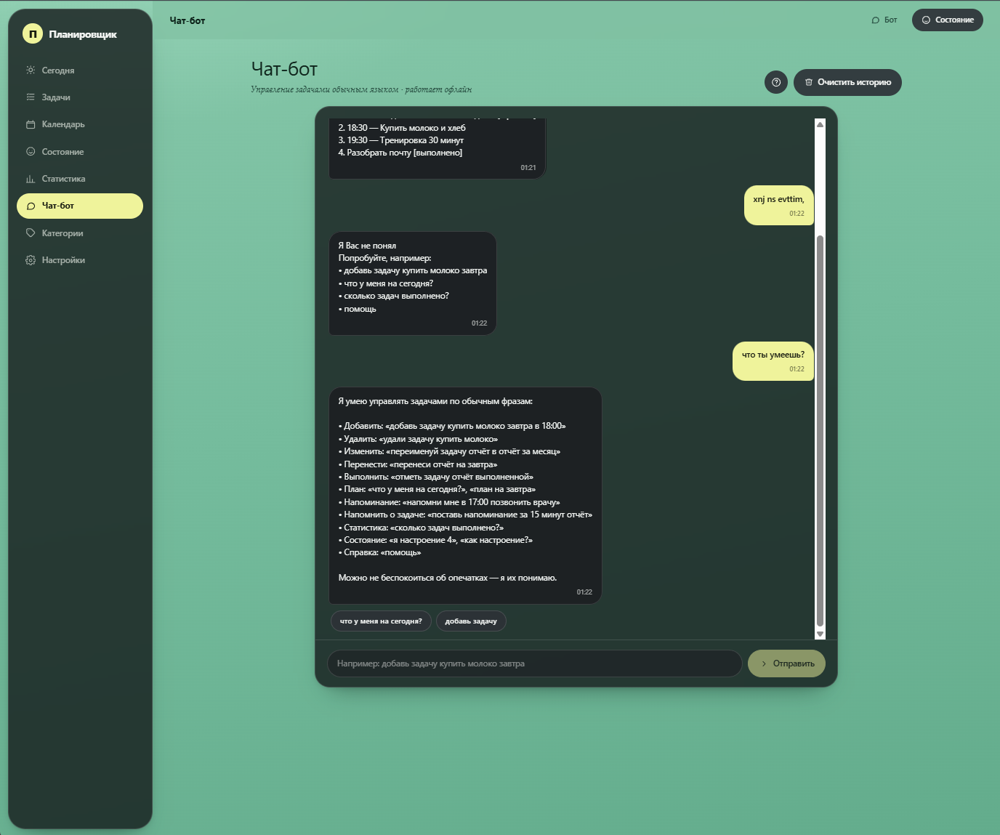
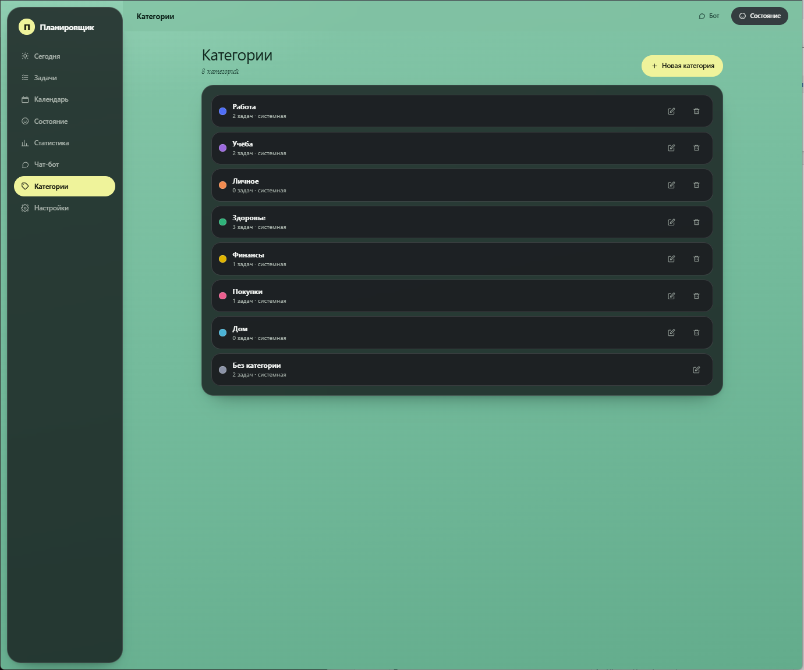
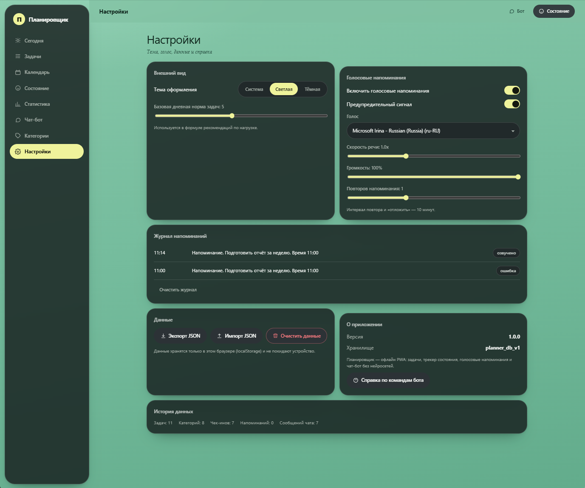

# Планировщик задач 

PWA-приложение для учёта задач, напоминаний и самочувствия. Работает офлайн, данные хранятся в браузере (localStorage), без сервера и регистрации.

## Стек

- React 18 + TypeScript 5.7 + Vite 6
- React Router 6 (HashRouter — работает при раздаче из любого подкаталога)
- Recharts (графики), SpeechSynthesis (озвучка напоминаний)
- Service Worker + манифест — устанавливается как PWA
- Vitest + jsdom — 68 автотестов

## Запуск

```bash
npm install
npm run dev        # разработка
npm run build      # сборка в dist/
npm run preview    # предпросмотр сборки
npm test           # тесты
```

## Экраны

### Сегодня


Главный экран дня: приветствие и дата, прогресс выполнения («Выполнено X из Y»), полоса лимита задач по рекомендации, быстрое добавление задачи текстом с авто-разбором даты («завтра в 18:00») и список задач, сгруппированный по секциям — просроченные, в работе, на сегодня, выполнено.

### Задачи


Полный список задач с фильтрами: поиск, категория, статус, приоритет, дата, архив. Есть массовые действия (выбрать несколько → отметить выполненными, перенести, удалить) и создание новой задачи через модальную форму.

### Календарь


Месячный вид с отметками по дням (запланировано / выполнено / просрочено) и панелью выбранного дня справа: задачи конкретной даты и кнопка «+ Задача». Навигация по месяцам и возврат к сегодняшнему дню.

### Состояние


Ежедневный чек-ин: шкала настроения (1–5) и уровня стресса (1–5) с эмодзи, необязательный комментарий. Ниже — комбинированный график «настроение / стресс / выполненные задачи» за 7, 14 или 30 дней и история чек-инов.

### Статистика


Сводка: выполнено сегодня, за 7 и 30 дней, серия дней подряд. График выполнения по дням за месяц и процент выполнения по категориям.

### Чат-бот


Управление задачами обычным языком: «добавь задачу купить молоко завтра в 18:00», «покажи задачи на сегодня», «что у меня на сегодня?», «отметь задачу X выполненной». Работает офлайн (регулярные правила + fuzzy-матчинг, без GPT). Есть подсказки-кнопки, очистка истории и помощь по командам.

### Категории


Список категорий задач с цветами, счётчиком задач и системными пометками. Создание, редактирование, удаление; задачи без категории попадают в «Без категории».

### Настройки


- **Внешний вид**: тема (системная / светлая / тёмная), базовая дневная норма задач.
- **Голосовые напоминания**: включение озвучки, предупредительный сигнал, выбор голоса, скорость, громкость, число повторов.
- **Журнал напоминаний**: сработавшие напоминания.
- **Данные**: экспорт в JSON, импорт, сброс к демо-данным.
- **О приложении / история данных**.

## Дизайн

Графитовые полупрозрачные плашки с матовым стеклом поверх шалфейно-зелёного холста, жёлтый акцент, pill-элементы, засечный шрифт в подзаголовках. Адаптив: сбоку — вертикальное меню (≥900px), на мобильных — нижняя навигация.

## Хранение данных

Ключ `planner_db_v1` в localStorage: задачи, категории, чек-ины, история чат-бота, настройки. Отдельно `planner_reminder_runtime_v1` — состояние активных напоминаний. Первый запуск создаёт демо-набор (8 категорий, 7 задач, 7 чек-инов).
